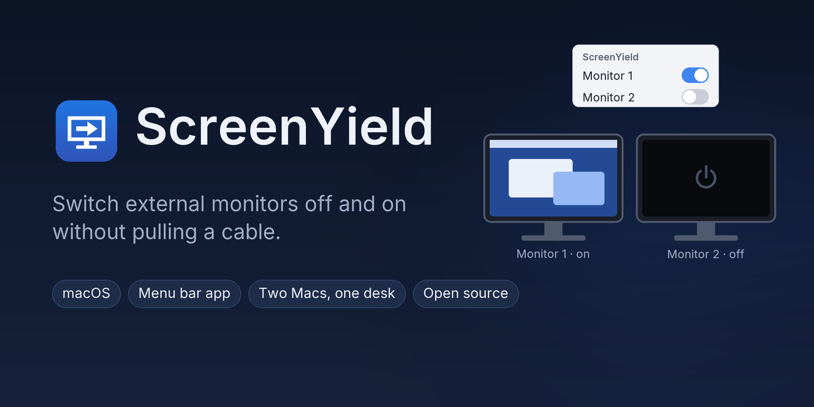
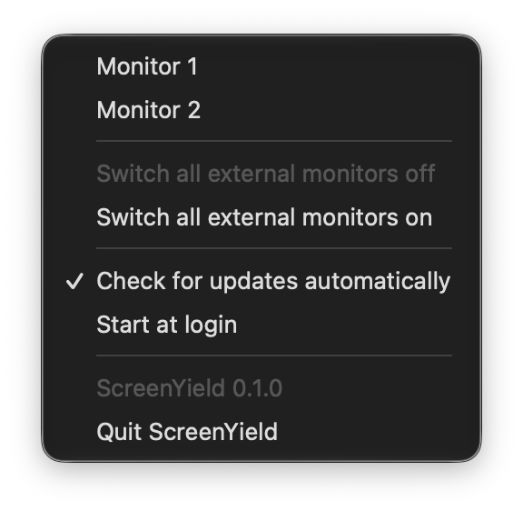

<p align="center"></p>

A small menu bar app for macOS that switches external monitors off and on again – one by one or
all together – without pulling a cable.

Made for two computers that share the same monitors (for example two MacBooks, each on its own dock
connected to both monitors): switch a monitor off on one Mac, and the monitor shows the other
computer. macOS moves windows, menu bar and Dock to the screens that remain, as if the cable had been
pulled. Switching it on again brings back the old arrangement.

<p align="center">
  
</p>
<p align="center"><em>Both monitors handed over to the other computer.</em></p>

- Monitors are numbered from left to right; a monitor that is off keeps its number.
- The last screen is never switched off (with the MacBook closed, one monitor stays on).
- Quitting ScreenYield, logging out or restarting switches every monitor on again. If ScreenYield
  ends unexpectedly, it switches them on at its next start.
- Whether a monitor shows the other computer by itself depends on its input setting (automatic
  input selection).
- The menu is in German or English, after the first preferred language of the system (System
  Settings → General → Language & Region); a change applies at the next start of ScreenYield.

Windows and Linux can do this out of the box (Windows: Win+P, "Disconnect this display";
Linux: display settings), so ScreenYield is for macOS only: macOS 11 or newer, Apple silicon and
Intel.

## Install

In Terminal:

```sh
curl -fsSL https://raw.githubusercontent.com/eckonator/ScreenYield/main/scripts/install-macos.sh | bash
```

This puts the newest version into `/Applications` and starts it. Alternatively download the disk
image (`ScreenYield-<version>-macOS.dmg`) from the
[releases](https://github.com/eckonator/ScreenYield/releases) and drag ScreenYield to Applications.

ScreenYield is signed with its own certificate, but not notarized by Apple. Started from the disk
image, macOS refuses it the first time: open System Settings → Privacy & Security and choose
"Open Anyway" (once). Installed with the command above, no such question comes up.

ScreenYield needs no permissions.

## Updates

ScreenYield asks GitHub for a newer version at start and every 6 hours (only this request is
sent; switch it off in the menu). If there is one, the menu shows "Update to …": one click
downloads it, checks that it is signed with the same certificate, replaces the app and starts it
again.

## Limits

- Switching a display off uses a private macOS function (the public interface has no way to do
  this). If a future macOS drops it, the menu says the version is not supported.
- A monitor that is unplugged while it is off cannot be switched on again by ScreenYield; it
  disappears from the menu.
- Behind an MST hub (one cable for both monitors), switching one monitor off may briefly make the
  other one renegotiate its picture.

## Files

- Settings: `~/Library/Application Support/ScreenYield/`
- Log: `~/Library/Logs/ScreenYield/screenyield.log`
- Start at login: `~/Library/LaunchAgents/de.eckonator.screenyield.plist`

## Build

```sh
cargo test
scripts/bundle-macos.sh   # dist/ScreenYield.app
scripts/make-dmg.sh       # dist/ScreenYield-<version>-macOS.dmg
```

## License

GPL-3.0-or-later, see [LICENSE](LICENSE).
